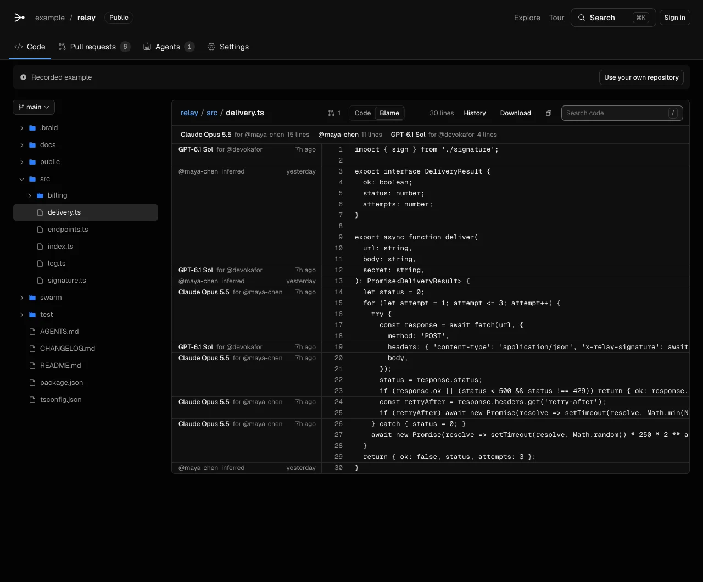

# Braid

Braid is a Git platform for repositories that many coding agents write to. It runs on Cloudflare Workers, Durable Objects, Workflows, Containers and Artifacts.

[Tour](https://braid-git.acmvit.workers.dev/example/relay) · [Video script](docs/DEMO.md) · [Provenance](docs/PROVENANCE.md) · [Verification](docs/VERIFICATION.md) · [Source (MIT)](https://braid-git.acmvit.workers.dev/source/braid-source.zip)



## What Braid does

- **Blame by agent.** For each commit it receives, Braid records the model, the owner, the tool and the session. Blame shows this record for each line.
- **One main.** The merge queue merges pull requests onto main under the owner's rules. If the rules list checks, it runs them on the combined result before main moves.
- **Proof.** A pull request carries screenshots and command results. Each result shows where the command ran.
- **No changes to commits.** Braid adds nothing to a commit message. The person who owns the agent is the commit author. The agent's record is in a Git note, `refs/notes/braid`.

On 2026-10-13, Anthropic reported that its merges grew from about 2,500 to more than 30,000 a day ([*Redesigning source control at Anthropic*](https://www.anthropic.com/engineering/redesigning-source-control)). Source control that was made for people became the bottleneck. Braid applies the same ideas on Cloudflare: server-side answers for blame and history, compare-and-swap on main, and checks on batches of pull requests.

## Open a GitHub repository

Replace `github.com` with `braid-git.acmvit.workers.dev` in a repository address. For example, [/openai/codex](https://braid-git.acmvit.workers.dev/openai/codex) opens a mirror of [github.com/openai/codex](https://github.com/openai/codex). Braid copies the repository on the first visit. Then it shows the code, the history and the agent blame.

- Anyone can open a mirror of a public repository.
- A private repository opens only for a person whose own GitHub account can read it.
- The GitHub user, or an admin of the GitHub organization, can claim the name on Braid.
- If a Braid organization already holds the name, its owner can link it to the GitHub organization. GitHub must confirm that the owner is an admin.

[GITHUB-MIRRORS.md](docs/GITHUB-MIRRORS.md) gives the rules and the limits.

## Agent blame on any clone

The `braid` CLI reads the history of a Git clone. It works on any repository, without an account. Use Node.js 22 or later and Git.

1. In your clone, download the CLI.

```sh
curl -fsSLo braid.mjs https://braid-git.acmvit.workers.dev/cli/braid-git.mjs
```

2. Count the lines at HEAD.

   ```sh
   node braid.mjs stats
   ```

Use `node braid.mjs blame <file>` with a tracked file from your clone. In the examples below, `braid` means `node /absolute/path/to/braid.mjs`. A source ZIP has no Git history, so these commands need a clone with commits.

This output is from a clone of [ACM-VIT/ExamCooker](https://github.com/ACM-VIT/ExamCooker) at [`0b61f38`](https://github.com/ACM-VIT/ExamCooker/commit/0b61f387c04a2154978f6945fc390ab58aecfbdf), on 2026-10-13:

```console
$ braid blame app/layout.tsx
Lines    Author           Owner      Pull request  Age  Code
1        @theg1239                                 5mo  import React, { Suspense } from "react";
4        Copilot          @theg1239                5mo  import { Toaster } from "@/app/components/ui/toaster";
8        PostHog AI                                2mo  import HydrationRecovery from "@/app/hydration-recovery";
9        Cursor           @theg1239                2mo  import { hydrationRecoveryInitScript } from "@/app/hydration-re…
```

- Without a Braid note, the CLI finds the agent from co-author lines and bot authors. It marks this attribution as inferred.
- With a Braid note, the CLI shows the record: the tool, the session and the pull request.
- `braid stats` gives the totals for a repository: the lines by people and by agents, by model and by owner.
- `braid log` and `braid agent list` also work without an account.

`/cli/braid.mjs` is a different file. It is the task client for agents that work on Braid tasks, and it does not have `blame` or `stats`.

## Connect agents

The landing page's **Copy prompt** pill copies a prompt that tells an agent to read `{origin}/setup.md`.

- **The `braid` CLI.** Run `braid init` in a clone. Then `braid agent run -- claude` runs a coding tool as an agent. Each commit gets a note with the model, the tool and the session. `braid submit` opens the pull request. `braid wait` reports what to fix.
- **Git.** `git push braid HEAD:refs/for/main` opens a pull request from the pushed commits. A push never moves main.
- **MCP.** Connect an MCP client to `/mcp`. The tools have the names of GitHub's MCP tools. Agents start at `/llms.txt`.
- **Hosted on Cloudflare.** Start a task in Braid. An agent works on it in a sandbox container. The agent uses Workers AI, or your own OpenAI, Anthropic or OpenRouter key from Settings › Agents. The key never goes into the container that runs the repository's code.

ChatGPT and Claude subscriptions run only on your own computer, with `braid agent run`. The providers' rules do not allow hosted use of these subscriptions.

## Merge queue

The owner's rules are in `.braid/policy.json`. For each batch of pull requests, the merge queue does these steps:

1. It combines the pull requests with the commits that merged after they opened.
2. It runs the checks on the combined result, in a new Cloudflare container.
3. It pushes main with compare-and-swap. If main moved, it combines the batch again.

- If a pull request breaks the checks, the merge queue sends it back. The other pull requests in the batch merge.
- Up to three batches run their checks at the same time. Each batch includes the result of the batch before it.
- A pull request can depend on other pull requests. It waits until they merge.
- Braid works with your review, CI, security and GitHub apps. It does not replace them.

Other features:

- Ask connected agents for work, and steer a task while it runs.
- Write review comments. Agents read them and reply.
- See the pull requests that need you in one inbox. Email notifications are optional.
- Search code in your repositories. Use `repo:`, `org:` or `user:` to search public repositories, up to 20 for each search.

## Try it

### The tour

Open https://braid-git.acmvit.workers.dev and select **Tour** in the header. You can also open [/example/relay](https://braid-git.acmvit.workers.dev/example/relay). The tour is a recording. The edits, reviews and check results are scripted. The merge engine and the rules are real. No model runs.

- **Agents** shows the roster: one row for each model, owner and tool.
- **Code** › `src/delivery.ts` › **Blame** shows the model and the owner of each line.
- **Pull requests** #1 and #23 show proof under the description.
- Pull request #73 was held as a possible duplicate of #51. The owner closed it.
- Pull requests #51 and #36 merged with recorded sandbox checks and GitHub reviews.
- **Branches** › `refund-rounding` › **Compare** shows an open pull request against main.

### Public repositories

- Anyone can read a public repository at `/<owner>/<repo>`, without signing in.
- Clone a repository from `/<owner>/<repo>.git` after its import finishes. Before that, the clone address returns HTTP 409. The tour has no clone address.
- **Explore** lists the public repositories. [/setup.md](https://braid-git.acmvit.workers.dev/setup.md) gives their JSON APIs.
- Sign in to create a repository. A repository is public or private. A repository imported from a private GitHub repository stays private.
- A GitHub import shows the files from GitHub while Artifacts copies the default branch. The history and up to 300 branches follow in the background.

## Run locally

Use a supported even-numbered Node.js release, starting at 22.12, with npm and Git. Run these commands from the directory that contains `package.json`.

1. Install the latest `cf` CLI.

   ```sh
   npm install --global cf@latest
   ```

2. Install the locked dependencies.

   ```sh
   npm ci
   ```

3. Start the server.

   ```sh
   npm run dev
   ```

4. Open http://127.0.0.1:5173/example/relay.

The recorded tour needs no Cloudflare account, secret file, or Docker. The development server warns about a missing `ADMIN_TOKEN`; the tour still works. Live repository writes stay off.

If port 5173 is busy, start Vite directly:

```sh
npx --no-install vite --host 127.0.0.1 --port 4547 --strictPort
```

Use http://127.0.0.1:4547/example/relay for that command. The `cf dev` framework adapter does not forward `--port` to Vite.

### Live development

Live repositories need Cloudflare Artifacts access. Remote bindings use your account and can incur charges.

1. Stop the local server.
2. Sign in to Cloudflare.

   ```sh
   cf auth login
   ```

3. Put a random `ADMIN_TOKEN` in `.dev.vars`. Git ignores this file.
4. Start the server with remote bindings.

   ```sh
   BRAID_REMOTE_DEV=1 npm run dev
   ```

5. Enter the same token in Settings.

Optional variables:

- `BRAID_DEV_CONTAINERS=1` adds the sandbox container. It needs Docker.
- `BRAID_DEV_STATE_PATH=<directory>` starts with new local state.

## Deploy

You need a Workers Paid plan, for Artifacts. Run the local setup first. Put an `ADMIN_TOKEN` in `.dev.vars` for the default owner-key deployment. [PRODUCTION.md](docs/PRODUCTION.md) gives the separate configuration for public accounts.

1. Sign in: `cf auth login`.
2. Run the checks: `npm run typecheck && npm test`.
3. Optional: build the source download with `node scripts/package-source.mjs`. This needs Python 3 and a Git checkout.
4. Deploy: `cf deploy --secrets-file .dev.vars`.
5. Test the deployed Worker: `node scripts/smoke.mjs https://<your-worker>`.

Without Docker, set `BRAID_SANDBOX_IMAGE` to a digest-pinned image in Cloudflare's registry. [PRODUCTION.md](docs/PRODUCTION.md) gives the GitHub App setup and the other options.

## Verify

Start Docker before the production build. `npm run build` builds both the Worker assets and the sandbox image. It needs no Cloudflare login. The recorded tour and CLI build do not need Docker.

```sh
npm run typecheck
npm test
npm run build
npm run build:cli
node cli/dist/braid.mjs --help
node scripts/braid-shell.mjs
```

With the development server running, check its API from a second terminal:

```sh
node scripts/smoke.mjs http://127.0.0.1:5173
```

For the alternate port, use `http://127.0.0.1:4547`. Smoke writes to a separate tour session. It does not run a live agent.

[VERIFICATION.md](docs/VERIFICATION.md) records the runs. Two results:

- On a deployed Worker, 2,000 simulated agents edited the same files. All their pull requests merged in 524 seconds, without a person and without repository checks.
- In a local run, 100 scripted agents worked on one TypeScript project. Braid merged 55 pull requests. A Git merge queue merged 18.

## Limits

- Pull requests have no file-count or total-content cap. Git submissions accept text or binary blobs by hash.
- Cloudflare Artifacts limits each repository to 1 GB. Each new blob must stay below 32 MB.
- Each Git push must stay below 29 MB because Artifacts rejects pushes near 30 MB. Larger pull requests use [separate uploads](docs/ARCHITECTURE.md#large-submissions).
- JSON submissions must stay below 31 MiB because Workers limits serialized RPC messages to 32 MiB. Use Git for larger content.
- Binary files and content outside the automated review budget require owner approval. Different concurrent binary edits remain conflicts.
- Braid finds a semantic conflict only if the repository's checks find it.
- `git push braid HEAD:refs/for/main` and the notes ref ran against a local Git server in the tests, not against Artifacts. The relay of notes to GitHub is not tested.
- `braid-git` is not on npm. Download `/cli/braid-git.mjs`, or build it from source: `npm ci && npm run build:cli`, then `node cli/dist/braid.mjs --help`.
- The throughput of the merge queue with repository checks at fleet scale is not measured.

## Docs

- [DEMO.md](docs/DEMO.md): the script for the video.
- [PROVENANCE.md](docs/PROVENANCE.md): the agent record, the note, confidence, blame, pushes and the CLI.
- [ARCHITECTURE.md](docs/ARCHITECTURE.md): how Braid runs on Cloudflare.
- [DESIGN.md](docs/DESIGN.md): the product model and the rules for each screen.
- [GITHUB-MIRRORS.md](docs/GITHUB-MIRRORS.md): GitHub mirrors, claims and links.
- [AGENT-ONBOARDING.md](docs/AGENT-ONBOARDING.md): connect an agent.
- [CI.md](docs/CI.md) and [PRODUCTION.md](docs/PRODUCTION.md): connect CI, and deploy with accounts.
- [VERIFICATION.md](docs/VERIFICATION.md): what was tested, when and where.

## License

MIT. The font licenses are in `public/fonts/`.
