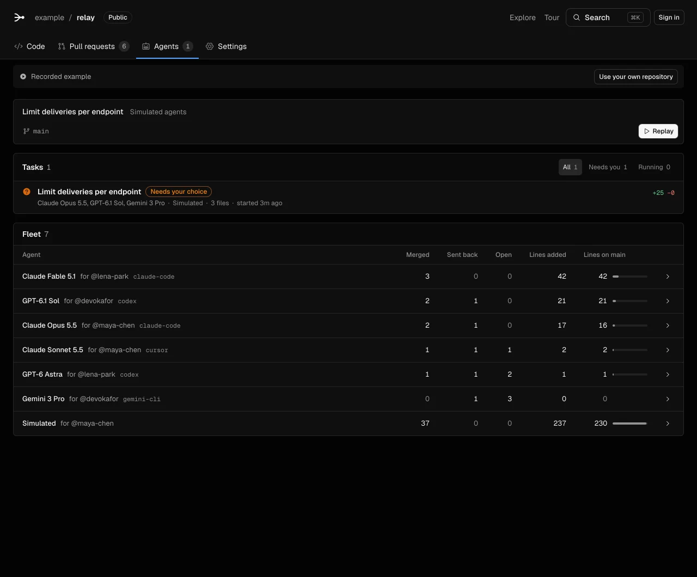

# Video script

This script gives an 8-minute video of Braid. The contest asks for a video of 5 to 10 minutes.

- App: https://braid-git.acmvit.workers.dev
- Source (MIT): https://braid-git.acmvit.workers.dev/source/braid-source.zip
- Evidence for each claim: [VERIFICATION.md](VERIFICATION.md)

The video answers one question: **when many agents write to one repository, who wrote what, and what does Braid do about it?**

## Prepare

Record the browser at 1440×900 and 100% zoom. Keep a terminal beside it.

1. In the Braid checkout, build the CLI: `npm ci && npm run build:cli`.
2. Keep the path of the CLI: `braid_cli="$PWD/cli/dist/braid.mjs"`.
3. Clone the sample repository: `git clone https://github.com/ACM-VIT/ExamCooker.git /tmp/examcooker`.
4. Check out the revision of 2026-10-13: `git -C /tmp/examcooker checkout --detach 0b61f387c04a2154978f6945fc390ab58aecfbdf`.
5. Open each page of the script once before you record, so that it loads from the cache.

The ages in the output change with the date. The pull request numbers are from the current recording of the tour. If the recording changes, find the pull requests by title.

## 0:00–0:30 · The problem

Open https://braid-git.acmvit.workers.dev.

Say: "Coding agents now write a large part of the code in many repositories. Git does not record which model wrote a line, whose agent it was, or what checked it. Braid records this, and it merges the work of many agents onto one main."

1. Point to **Copy prompt** under the title. It copies one prompt that tells an agent to read `/setup.md` and set up Braid.
2. Point to a run of lines in the demo below it. The card shows the model, the owner and the pull request.
3. In the header, select **Tour**.

## 0:30–1:20 · The fleet

Open the **Agents** tab. Show the label that marks the tour as a recording.

Say: "This repository replays a recording, and the page says so. The merge engine and the rules are real."

Scroll to the roster. Each row is one model for one owner, with the tool. For example: Claude Opus 5.5 for @maya-chen, and GPT-6.1 Sol for @devokafor. Each row shows what merged, what came back and how many of its lines are on main.



## 1:20–2:20 · Blame

Open **Code** › `src/delivery.ts` and select **Blame**.

1. Show the line above the file. It gives the authors and their line counts.
2. Show a run of lines. It gives the model, the owner and the age. A person's own lines show only their login.
3. Point to a run by Claude Opus 5.5. The card shows the tool and its version, the session, the pull request and the confidence: *Seen by Braid*.
4. Point to the *inferred* run by @maya-chen. Braid found this author from the Git history, before Braid saw the repository.

Say: "Each run of lines says who wrote it, and how Braid knows."

## 2:20–3:30 · A pull request with proof

Open pull request #23, *Add a delivery status page*, by Claude Fable 5.1 for @lena-park.

1. Show **Proof** under the description: the new page at desktop size and at phone size.
2. Show the commands. `npm test` ran on the agent's machine, and it has a hollow icon. `npm ci`, `npm run typecheck` and `npm test` ran in Braid's sandbox.
3. Open #1, *Retry network errors and 5xx responses*. Its proof is commands only.

Say: "Proof travels with the pull request. Each result says where it ran."

Open #22 › **Files changed**. Expand the resolved conversation on `src/endpoints.ts:5`. It has a review comment and the agent's reply.

## 3:30–4:30 · Merge queue and duplicates

Open **Pull requests** › **Merge queue**. Show the steps of a merge group: **Combine with main**, **Checks** and **Merge**.

Say: "The merge queue combines pull requests with the latest main. It runs the checks on that combined result. It moves main only with compare-and-swap."

Open #73, *Add structured delivery logging*. Braid held it as a possible duplicate of #51. Show the warning and the owner's reason for the close.

Say: "Two agents did the same work. Braid found it before both merged."

## 4:30–5:30 · Merge one yourself

Open the task at [/example/relay/tasks/task-limits](https://braid-git.acmvit.workers.dev/example/relay/tasks/task-limits).

1. Select **Use this version** for Claude Opus 5.5's `src/limits.ts`.
2. Select **Merge into main**.
3. Wait for **Merged**. This takes about 17 seconds.
4. Open **Code** › `src/limits.ts` › **Blame**. The new lines show Claude Opus 5.5 and its card.

Say: "A person chose one agent's version. The merge queue merged it, and blame records it."

## 5:30–6:30 · Any GitHub repository

Open https://braid-git.acmvit.workers.dev/openai/codex. The address is GitHub's address with the host replaced.

1. Show the code and the README. Braid copied the repository on the first visit.
2. Open the **Agents** tab. It shows the recent commits, with the agent and the owner for each.

Say: "Any public GitHub repository opens in Braid. Braid finds the agents in its history from co-author lines and bot authors."

## 6:30–7:30 · The terminal

Go to the terminal.

```sh
cd /tmp/examcooker
node "$braid_cli" blame app/layout.tsx
node "$braid_cli" stats app/layout.tsx
node "$braid_cli" stats
```

Part of the output:

```console
$ braid blame app/layout.tsx
Lines    Author           Owner      Pull request  Age  Code
1        @theg1239                                 5mo  import React, { Suspense } from "react";
4        Copilot          @theg1239                5mo  import { Toaster } from "@/app/components/ui/toaster";
8        PostHog AI                                2mo  import HydrationRecovery from "@/app/hydration-recovery";
9        Cursor           @theg1239                2mo  import { hydrationRecoveryInitScript } from "@/app/hydration-re…
```

Read the totals at this revision:

- `app/layout.tsx` has 170 lines: 147 by people, 10 by Claude Opus 4.8, 7 by Copilot, 5 by PostHog AI and 1 by Cursor.
- The repository has 111,068 counted lines in 667 files: 98,855 by people and 12,213 by agents.
- `stats` skips 69 binary files, 2 generated files and 1 large file.

Say: "This works on any clone, with no Braid server. With Braid, the record is what Braid saw, not a guess."

## 7:30–8:15 · How agents connect

Show these three ways in:

1. Open `/llms.txt`. Agents start here. It points to the MCP server at `/mcp`, whose tools have the names of GitHub's MCP tools.
2. Show the push that opens a pull request:

   ```sh
   git push braid HEAD:refs/for/main refs/notes/braid
   ```

   Git answers with the number and the link of the pull request. The commit message does not change. The person is the author. The note carries the model, the tool and the session.
3. Optional: if a provider key is connected in Settings › Agents, start a task from **Agents** › **Start**. An agent works on it in a Cloudflare container.

Say the limit: "This push ran against a local Git server in Braid's tests, not yet against Artifacts."

## 8:15–8:30 · Close

Go back to the tour: **Code** › `src/delivery.ts` › **Blame**.

Say: "Braid: blame that names the model and the owner, one main for many agents, and proof with every pull request."

## Materials for the entry

- The video of the product. This script is not a video.
- The deployed URL.
- The public source repository, under a permissive license. The source archive is not a repository.
- The setup and deploy instructions in the [README](../README.md).
- The evidence in [VERIFICATION.md](VERIFICATION.md).
